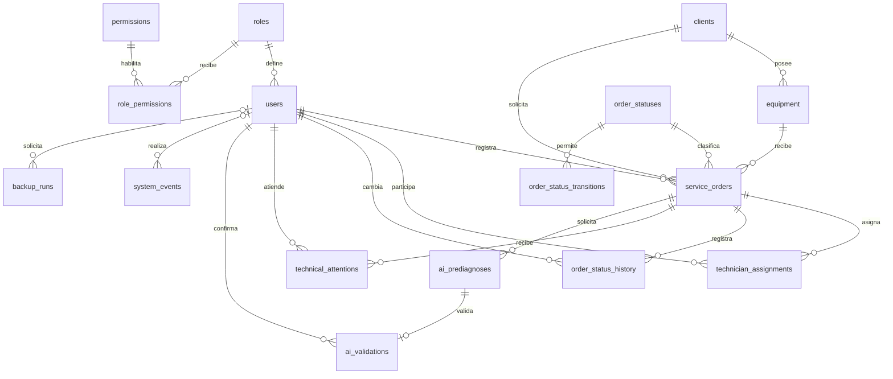

# Modelo PostgreSQL

El modelo cubre las historias del backlog completo. Los endpoints y pantallas actuales cubren los sprints 1, 2 y 3; las otras tablas permiten continuar los sprints siguientes.

| Tablas | Propósito |
|---|---|
| `roles`, `permissions`, `role_permissions` | Catálogos y permisos por rol |
| `users` | Usuarios activos/inactivos, rol y contraseña BCrypt |
| `clients` | Identificación y datos de contacto del cliente |
| `equipment` | Equipo y cliente propietario actual |
| `order_statuses`, `order_status_transitions` | Estados y transiciones permitidas |
| `service_orders` | Recepción del equipo, cliente al ingreso, problema y cierre |
| `technician_assignments` | Historial de asignaciones, máximo una vigente por orden |
| `order_status_history` | Cambios de estado, usuario responsable y fecha |
| `technical_attentions` | Diagnóstico, pruebas, repuestos, observaciones, resultado y cierre de atención |
| `ai_prediagnoses` | Solicitud y respuesta/error estructurada de Gemini, proveedor y modelo |
| `ai_validations` | Decisión del técnico y, si aplica, una versión modificada del prediagnóstico |
| `system_events` | Auditoría de operaciones |
| `backup_runs` | Estado, ubicación protegida y checksum de respaldos PostgreSQL |
| `monitoring_checks` | Resultados de comprobaciones de componentes |
| `system_settings` | Configuración del sistema |



Los IDs de registros son UUID. Roles, permisos y estados usan códigos estables. `timestamptz` representa fechas absolutas; PostgreSQL las presenta según la zona de la conexión. Las tablas principales actualizan automáticamente `updated_at`.

Decisiones del modelo:

- Un usuario tiene un rol, como en la interfaz actual. Un rol tiene múltiples permisos.
- Los documentos se comparan sin distinguir mayúsculas; la interfaz actual no permite reutilizar el mismo número aunque cambie el tipo.
- Una serie no vacía es única sin distinguir mayúsculas. Solo el tipo `Otro` permite omitirla.
- Clientes con equipos u órdenes y equipos con órdenes no se eliminan. Las órdenes y sus registros históricos mantienen sus referencias.
- La orden guarda el cliente al momento de recepción. El trigger comprueba el propietario al registrar la orden, pero una reasignación posterior del equipo no altera el cliente histórico de la orden.
- El backend de órdenes reutiliza `service_orders`, `technician_assignments` y `order_status_history`; Flyway V4 agrega la fecha de ingreso y la transición directa de pendiente a en atención, sin recrear tablas.
- El código visible se genera desde la secuencia PostgreSQL (`OS-` más el correlativo único). La prioridad `MEDIA` de la interfaz se guarda como `NORMAL`, valor ya permitido por el esquema.
- Los técnicos consultan la lista y el detalle filtrados por el usuario de sesión; la API no acepta un identificador de técnico enviado por el cliente para decidir el alcance.
- Solo usuarios activos con rol técnico pueden generar nuevas asignaciones, atenciones o validaciones. El historial se conserva si luego el técnico se desactiva.
- Una orden admite una sola asignación sin fecha de fin. Para reasignarla debe finalizarse la asignación anterior dentro de una transacción.
- Los estados contemplados son `PENDIENTE`, `ASIGNADA`, `EN_ATENCION`, `FINALIZADA`, `CERRADA` y `CANCELADA`. El trigger exige una transición catalogada. Un cierre/cancelación requiere fecha y resumen; los módulos futuros deberán insertar también el historial en la misma transacción.
- Los prediagnósticos conservan datos de entrada JSON, respuesta o error. No almacenes claves de Gemini en estas tablas ni en `system_settings`.
- Flyway V5 amplía las tablas existentes para guardar avances de atención, metadatos de finalización y la respuesta JSON estructurada de Gemini; la clave se configura solo mediante `GEMINI_API_KEY` en el entorno del backend. Las decisiones `ACEPTADO`, `MODIFICADO` y `DESCARTADO` no completan el diagnóstico técnico definitivo.
- Los endpoints de indicadores calculan los conteos directamente desde órdenes; el promedio de órdenes finalizadas usa el tiempo entre la creación de la orden y `finalized_at`, y omite las órdenes sin fecha de finalización. Los filtros de fecha se aplican sobre la fecha de recepción y los filtros por técnico usan el historial de asignaciones.
- `system_events` registra actor, tipo de evento, entidad, resultado y detalle; nunca se almacenan contraseñas, tokens o claves de API. Los registros históricos previos a Flyway V6 se conservan y se marcan como exitosos porque el esquema anterior solo guardaba operaciones completadas.
- `backup_runs` guarda metadatos de respaldos generados con `pg_dump` en formato custom. Los archivos quedan fuera del frontend en `%USERPROFILE%\clinica-backups` por defecto; define `CLINICA_BACKUP_DIR` para usar otra ubicación protegida y `PG_DUMP_PATH` si `pg_dump` no está en el `PATH`. La contraseña se toma de la configuración de la conexión PostgreSQL del servidor y se pasa al proceso de respaldo por su entorno, nunca como argumento ni en la respuesta HTTP.
- La aplicación no restaura respaldos automáticamente. La restauración debe probarse en una base desechable y separada de la base activa.
- El monitoreo consulta PostgreSQL y registra las verificaciones. El estado de Gemini indica únicamente si hay una clave configurada; no hace llamadas periódicas ni afirma disponibilidad sin una verificación real.

## Endpoints actuales

Todas las mutaciones requieren `X-Requested-With: XMLHttpRequest`. Login y seguimiento público no requieren sesión; las demás rutas requieren una sesión activa y permiso del rol. Angular añade el encabezado. No se habilita CORS: el navegador accede mediante el proxy del mismo origen.

| Endpoint | Acceso |
|---|---|
| `GET /api/health` | Público |
| `POST /api/auth/login` | Público, credenciales |
| `POST /api/auth/logout` | Sesión activa |
| `GET /api/bootstrap` | Sesión; datos filtrados por permisos |
| `GET, POST /api/clients` | Permiso `clients` |
| `GET /api/clients/{id}` | Permiso `clients`; cliente, equipos y órdenes relacionados |
| `PUT, DELETE /api/clients/{id}` | Permiso `clients`; la eliminación se rechaza si hay equipos u órdenes vinculados |
| `GET, POST /api/equipment` | Permiso `equipment` |
| `PUT, DELETE /api/equipment/{id}` | Permiso `equipment` |
| `GET /api/equipment/{id}/history` | Permiso `equipment`; filtros opcionales `status`, `from`, `to` |
| `GET /api/orders` | Permiso `orders` o `assigned-orders`; los técnicos reciben solo sus órdenes asignadas |
| `POST /api/orders` | Permiso `orders`; registra la orden como `PENDIENTE` |
| `GET /api/orders/{id}` | Permiso `orders` o `assigned-orders`; acceso limitado a órdenes propias para técnicos |
| `PUT /api/orders/{id}` | Permiso `orders` |
| `GET /api/orders/mine` | Permiso `assigned-orders`; filtra por el usuario autenticado |
| `GET /api/orders/technicians` | Permiso `assign-technicians` (Personal de Atención y administrador); solo técnicos activos |
| `POST /api/orders/{id}/assignment` | Permiso `assign-technicians` (Personal de Atención y administrador); guarda responsable, fecha y observaciones |
| `PATCH /api/orders/{id}/status` | Permiso `orders` o `attend-orders`; registra el historial en la misma transacción |
| `GET, PUT /api/orders/{id}/attention` | Técnico asignado o permiso `attend-orders`; guarda avances sin finalizar |
| `POST /api/orders/{id}/finalize` | Técnico asignado o permiso `attend-orders`; exige orden EN_ATENCION y diagnóstico, actividades y resultado |
| `GET, POST /api/orders/{id}/prediagnoses` | Técnico asignado o permiso `ai-prediagnosis`; generar requiere `GEMINI_API_KEY` |
| `PATCH /api/prediagnoses/{id}/validation` | Técnico asignado o permiso `ai-prediagnosis`; registra aceptación, modificación o descarte |
| `GET /api/tracking/orders` | Permiso `service-tracking`; técnicos limitados a sus órdenes asignadas |
| `GET /api/tracking/orders/{id}` | Permiso `service-tracking`; devuelve detalle interno, eventos y prediagnósticos validados |
| `POST /api/public/tracking` | Público; requiere código `OS-...` y teléfono exacto asociado; solo devuelve datos mínimos |
| `GET, POST /api/users` | Permiso `users` (administrador) |
| `PUT /api/users/{id}` | Permiso `users` |
| `PATCH /api/users/{id}/active` | Permiso `users` |
| `GET, PUT /api/permissions` | Administración; no se modifican privilegios protegidos |
| `GET /api/indicators/dashboard` | Permiso `service-indicators`; conteos por estado y órdenes por mes |
| `GET /api/indicators/services` | Permiso `service-indicators`; filtros opcionales `from`, `to`, `status` y `technician` |
| `GET /api/admin/audit` | Administrador; filtros, búsqueda y paginación de eventos |
| `GET /api/admin/backups` | Administrador; historial de respaldos |
| `POST /api/admin/backups` | Administrador; ejecuta `pg_dump`, bloqueando ejecuciones simultáneas |
| `GET /api/admin/backups/{id}/download` | Administrador; descarga segura de un respaldo completado |
| `GET /api/admin/monitoring` | Administrador; estado del backend, PostgreSQL y configuración de Gemini |

Para que funcione la generación de respaldos, instala las herramientas cliente de PostgreSQL y asegúrate de que `pg_dump` sea ejecutable por la cuenta del backend. En Windows, si no está disponible en `PATH`, configura `PG_DUMP_PATH` con la ruta completa, por ejemplo `C:\Program Files\PostgreSQL\18\bin\pg_dump.exe`. El respaldo genera un archivo custom (`.dump`) y su checksum SHA-256; un intento que no genera un archivo válido queda como error, no como éxito.

Procedimiento de prueba de restauración, únicamente contra una base de datos temporal:

```powershell
createdb -U postgres clinica_restore_test
pg_restore --no-owner --no-privileges --dbname=clinica_restore_test "C:\ruta\protegida\respaldo.dump"
```

Verifica las tablas y datos restaurados en `clinica_restore_test` y elimina esa base de prueba manualmente cuando hayas terminado. No ejecutes `pg_restore` contra la base activa; la aplicación no ofrece restauración automática.

Las listas de Angular se cargan al recuperar la sesión. Las mutaciones actualizan el estado local únicamente tras la confirmación del servidor. Recargar la página vuelve a consultar PostgreSQL y refleja cambios realizados desde otra computadora.

Para habilitar prediagnósticos, configure `GEMINI_API_KEY` como variable de entorno del proceso Spring Boot y opcionalmente `GEMINI_MODEL` (valor predeterminado: `gemini-3.8-flash`) y `GEMINI_TIMEOUT_MS` (valor predeterminado: `120000`). El nombre del modelo se envía directamente a Gemini, por lo que también se pueden configurar modelos nuevos sin esperar a que Spring AI agregue una constante para ellos. En Windows, `scripts/Start-Backend.ps1` solicita la clave de forma oculta en el primer inicio y la guarda cifrada con DPAPI en `.local\gemini-api-key.dpapi`; use `-ActualizarClaveGemini` para cambiarla. Sin clave, el backend puede iniciar y la generación responde explícitamente que el proveedor no está configurado. La clave nunca se envía al navegador ni se guarda en PostgreSQL.

El estado de Gemini en monitoreo permanece en advertencia mientras no se haya realizado una generación real. Después de una solicitud real registra si el proveedor completó correctamente o falló, sin almacenar la clave ni detalles sensibles del error.

El seguimiento público verifica el teléfono registrado del cliente vinculado a la orden junto al código y responde con un error genérico ante coincidencias fallidas. No expone los datos de cliente, el problema reportado, observaciones internas ni diagnósticos. El esquema no dispone de un indicador de cliente inactivo; por ello, el backend solo permite la eliminación física cuando el cliente no tiene equipos ni órdenes relacionados.
